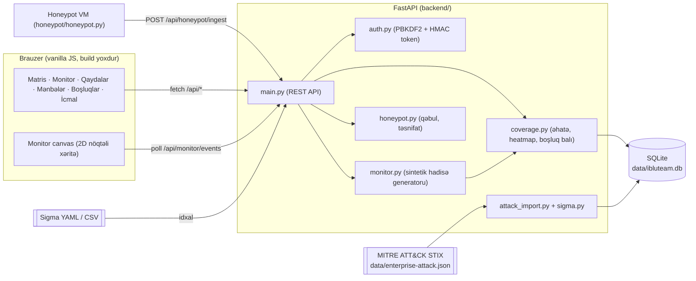

# Arxitektur

## Məlumat axını

1. **ATT&CK** STIX faylı açılışda bir dəfə bazaya yüklənir: taktikalar, texnikalar, alt-texnikalar, Windows log mənbələri, qrup sayı, ləğv olunmuş ID-lər. Yeniləmək üçün faylı əvəz edib `python run.py --reimport-attack` işlədin.
2. **Qaydalar** əl ilə, Sigma YAML və ya CSV ilə daxil olur. Sigma etiketləri (`attack.t1059.001`) texnikaya, logsource log mənbəyinə təklif kimi bağlanır.
3. **Əhatə** hər sorğuda qaydalardan və log mənbəyi vəziyyətindən hesablanır (`coverage.py`), saxlanmır. Beləliklə statuslar köhnələ bilməz.
4. **Monitor** hadisələri texnikaların çəkisinə görə seçir, nəticəni (aşkarlandı, qismən, qaçırıldı) cari əhatədən götürür. Qayda əlavə edib test etsəniz və ya log mənbəyini söndürsəniz, monitor dərhal dəyişir.

## Təhlükəsizlik

- Oxuma açıqdır, dəyişiklik üçün giriş lazımdır. Token 12 saat etibarlıdır, HMAC ilə imzalanır, gizli açar `data/.secret` faylındadır.
- Parollar PBKDF2-SHA256 (200 000 iterasiya) ilə saxlanılır. Uğursuz giriş cəhdləri məhdudlaşdırılır.
- İlk işə salmada `admin` yaranır. Parol `IBT_ADMIN_PASSWORD` ilə verilir, verilməzsə təsadüfi yaradılıb konsola bir dəfə çap olunur.
- Monitor sintetikdir: IP-lər sənəd aralığından (RFC 5737), mənbələr məlumat mərkəzi şəhərləridir. Real təşkilat datası yoxdur.
