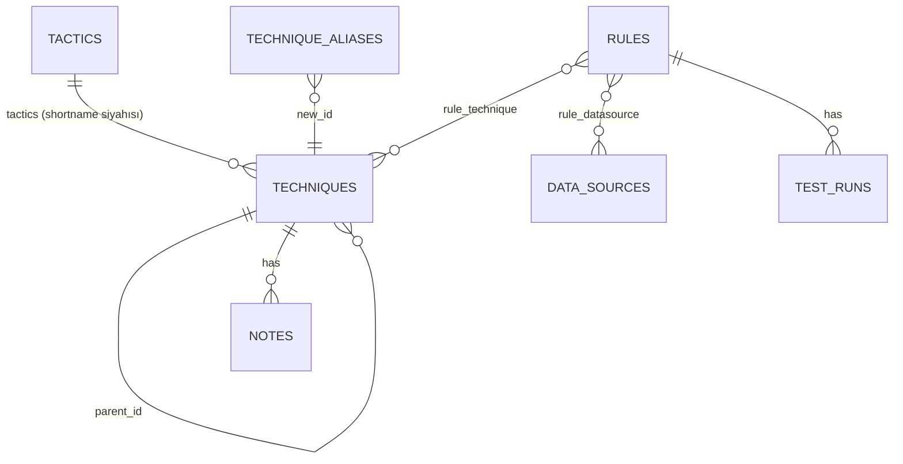

# Data modeli

SQLite (`data/ibluteam.db`), SQLAlchemy modelləri: `backend/models.py`. Sxem açılışda `backend/migrate.py` ilə yenilənir, köhnə baza pozulmur.

| Cədvəl | Əsas sahələr | Qeyd |
|---|---|---|
| `tactics` | `shortname` (PK), `name`, `ext_id`, `position` | ATT&CK taktikaları |
| `techniques` | `id` (PK, `T1059.001`), `name`, `is_sub`, `parent_id`, `tactics`, `platforms`, `description`, `url`, `data_sources`, `group_count` | `data_sources` ATT&CK analitiklərindən (`\|` ilə ayrılıb), `group_count` istifadə edən qrup sayı |
| `technique_aliases` | `old_id` (PK), `new_id` | Ləğv olunmuş ID → yeni ID |
| `rules` | `id`, `name`, `source`, `status` (`draft/active/disabled`), `quality` (1 ilə 5), `tested`, `last_tested`, `logsource`, `description`, `content` | `content` xam qayda mətni (Sigma, SPL, KQL) |
| `rule_technique` | `rule_id`, `technique_id` | Qayda ↔ texnika |
| `data_sources` | `id`, `name` (unikal), `category`, `description`, `collector`, `collected`, `updated_at` | `collected` = SIEM-ə həqiqətən toplanır |
| `rule_datasource` | `rule_id`, `datasource_id` | Qaydanın tələb etdiyi mənbələr |
| `test_runs` | `id`, `rule_id`, `tested_at`, `result` (`pass/fail`), `method`, `notes`, `tester` | Test qeydləri |
| `notes` | `id`, `technique_id`, `text`, `priority` | Texnikaya qeydlər, boşluq prioritetinə təsir edir |
| `honeypot_events` | `id`, `ts`, `sensor`, `src_ip`, `src_port`, `dst_port`, `proto`, `service`, `category`, `technique_id`, `payload`, `lat`, `lon`, `place`, `simulated` | Honeypot hadisələri, 30 gündən sonra silinir |
| `users` | `id`, `username` (unikal), `password_hash`, `role` (`admin/analyst`) | PBKDF2-SHA256 |
| `meta` | `key`, `value` | ATT&CK mənbəyi, yenilənmə tarixi, miqrasiya işarələri |

## API xülasəsi

Oxuma açıqdır. `POST`, `PUT`, `DELETE` üçün `Authorization: Bearer <token>` lazımdır (`POST /api/auth/login`).

| Endpoint | Təsvir |
|---|---|
| `GET /api/matrix?platform=` | Taktika sütunları, texnikalar, alt-texnikalar, statistika |
| `GET /api/stats?platform=` | Əhatə, qayda, log mənbəyi və test statistikası |
| `GET /api/techniques/{id}` | Detail: təsvir, qaydalar, test qeydləri, lazım olan log mənbələri |
| `GET/POST/PUT/DELETE /api/rules` | Qaydalar. `POST /api/rules/{id}/tests`, `DELETE /api/tests/{id}` |
| `POST /api/rules/upload-sigma`, `/import-csv` | İdxal |
| `GET/PUT/POST /api/data-sources` | Log mənbəyi kataloqu |
| `GET /api/gaps?platform=` | Prioritetləşdirilmiş boşluqlar |
| `GET /api/export/matrix.json`, `matrix.csv`, `gaps.csv`, `navigator` | İxrac |
| `GET /api/monitor/config`, `/api/monitor/events` | Live Detection Monitor |
| `POST /api/honeypot/ingest` | Sensor hadisələri (X-Sensor-Key ilə) |
| `GET /api/honeypot/summary`, `events`, `live`, `export.csv`, `agent` | Statistika, hadisələr, Monitor axını, ixrac, agent faylı |
| `POST /api/honeypot/simulate`, `key`; `PUT .../settings`; `DELETE .../events` | Simulyasiya, sensor açarı, qəbulu aç/söndür, silmə (açar və silmə admin üçün) |
| `GET/POST/DELETE /api/users` | İstifadəçilər (admin) |

İnteraktiv sənəd: `/docs`.
