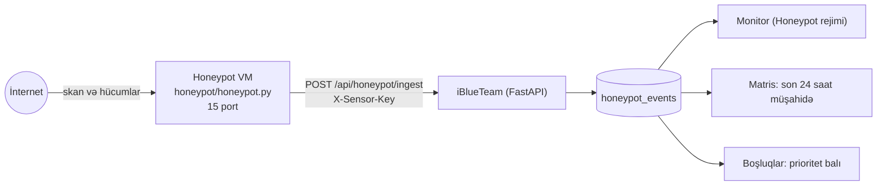

# Honeypot inteqrasiyası

Honeypot, açıq portlara gələn real skan və hücum cəhdlərini toplayır və iBlueTeam-ə göndərir. Platformada hər hadisə ATT&CK texnikasına uyğunlaşdırılır, Monitor-da «Honeypot» rejimində xəritədə göstərilir və matrisdə, boşluq siyahısında «müşahidə olunan» siqnal kimi istifadə olunur.



## Komponentlər

| Fayl | Rolu |
|---|---|
| `honeypot/honeypot.py` | Sensor agenti. Yalnız standart kitabxana. Portları dinləyir, banner göndərir, ilk baytları qeydə alır. Heç nə icra etmir |
| `honeypot/sim_client.py` | Öz honeypot-unuza sınaq trafiki göndərir (hər kateqoriyadan) |
| `backend/honeypot.py` | Təsnifat, ATT&CK uyğunlaşdırması, simulyasiya |
| `backend/geo.py` | IP → yer (ixtiyari GeoIP bazası) |
| `frontend/js/honeypot.js` | Honeypot səhifəsi |

## Default portlar

21 FTP, 22 SSH, 23 Telnet, 25 SMTP, 80 HTTP, 110 POP3, 139 NetBIOS, 443 HTTPS, 445 SMB, 1433 MSSQL, 3306 MySQL, 3389 RDP, 5900 VNC, 6379 Redis, 8080 HTTP-Alt.

## Təsnifat (heuristik)

Təsnifat port və ilk baytlara əsaslanır, hücumçunun niyyəti haqqında iddia deyil.

| Kateqoriya | Şərt | ATT&CK |
|---|---|---|
| Exploit cəhdi | Məzmunda tanınan imza (`${jndi:`, `/bin/sh`, `cmd.exe`, `../../`, `union select` və s.) | T1190 |
| Brute force | Giriş cəhdi əlaməti (USER, PASS, login) **və ya** 10 dəqiqədə eyni IP, eyni portda 5 və daha çox bağlantı (SSH, FTP, Telnet, POP3, VNC) | T1110 |
| Veb yoxlama | HTTP/HTTPS portlarında məzmunlu sorğu (`/.env`, `/wp-login.php` və s.) | T1595.002 |
| SMB cəhdi | 139 və 445 portlarında məzmunlu sorğu | T1210 |
| RDP cəhdi | 3389 portunda məzmunlu sorğu | T1133 |
| Verilənlər bazası | 1433, 3306, 6379 portlarında məzmunlu sorğu | T1190 |
| Skan | Yalnız bağlantı (məzmun yoxdur) və ya yuxarıdakılara uyğun gəlməyən hər şey | T1595 |

`T1595` və `T1595.002` Reconnaissance taktikasına aiddir və platformu «PRE» olduğundan Windows görünüşündə yoxdur. «Bütün platformalar» görünüşündə görünürlər. Monitor-un Honeypot rejimi nəticəni bütün platformalar üzrə hesablayır.

## Platformada istifadə

- **Honeypot səhifəsi:** statistika (24 saat), kateqoriya və port üzrə paylanma, ən aktiv mənbələr, son hadisələr cədvəli (filtr və CSV ixracı), sensor vəziyyəti, açar idarəsi, simulyasiya, quraşdırma əmri.
- **Monitor:** «Sintetik / Honeypot» keçidi. Honeypot rejimində oxlar real (və ya simulyasiya) hadisələri göstərir. Rəng, həmin texnikanın cari əhatəsindən gəlir: «bu hücum bizə qarşı olsaydı, qaydalarımız onu aşkarlayardımı?»
- **Matris:** son 24 saatda hadisə olan texnikaların xanasında kiçik nişan (sayla). Panelde «Honeypot» sətri.
- **Boşluqlar:** «Honeypot» sütunu. Prioritet balına `min(20, hadisə sayı)` əlavə olunur.

## Quraşdırma

1. Platformada `admin` ilə daxil olun, Honeypot səhifəsində **Sensor açarı yarat** düyməsini basın. Açar yalnız bir dəfə göstərilir.
2. Platformanı honeypot VM-in görə biləcəyi şəkildə işə salın: `python run.py --lan`. Şəxsi şəbəkə və ya WireGuard tövsiyə olunur, platformanı internetə açmayın.
3. Ayrı VM-də agenti işə salın:
   ```bash
   sudo python3 honeypot.py --url http://PLATFORMA_IP:8000 --key hp_XXXX --name hp-1 --user nobody
   ```
   1024-dən aşağı portlar üçün `sudo` lazımdır. `--user nobody` portlar açılandan sonra imtiyazları endirir. Root olmadan sınaq üçün `--offset 10000` (22 → 10022).
4. Real IP-lərin xəritədə görünməsi üçün (ixtiyari): pulsuz DB-IP «IP to City Lite» mmdb faylını `data/dbip-city-lite.mmdb` adı ilə qoyun, `pip install maxminddb` edin və serveri yenidən başladın. Baza olmadan hadisələr siyahıda və statistikada görünür, xəritədə yox.

## Simulyasiya və test

- **Honeypot səhifəsi → Hadisə yarat:** sintetik hadisələr (mənbə şəhərləri, sənəd aralığından IP). `simulyasiya` işarəsi daşıyır, filtrlə gizlədilir, ayrıca silinir.
- **sim_client.py:** real honeypot-unuza hər kateqoriyadan sınaq trafiki göndərir. Fərqli regionlardakı öz VM-lərinizdən işlədib fərqli mənbələr görə bilərsiniz. Yalnız öz honeypot-unuza istifadə edin.

## Etibarlılıq və təhlükəsizlik

- Giriş sensor açarı ilə qorunur (bazada yalnız SHA-256 hash-i). Yanlış açar 401, qəbul söndürülübsə 403 qaytarır, uğursuz cəhdlər məhdudlaşdırılır.
- Platforma əlçatmaz olanda agent hadisələri lokal fayla (`honeypot-spool.jsonl`) yazır və əlaqə qayıdanda göndərir.
- Agent hər mənbə IP üçün dəqiqədə 30 hadisə ilə məhdudlaşır və 300 eyni vaxtlı bağlantıdan çoxunu qəbul etmir.
- Parol sətirləri (`PASS ...`) agentdə və serverdə gizlədilir (`***`), məzmun 512 simvola qısaldılır.
- İnterfeysdə məzmun həmişə HTML-dən təmizlənmiş göstərilir (hücumçu nəzarətindədir), CSV ixracında formula inyeksiyasından qorunma var.
- Hadisələr 30 gündən sonra avtomatik silinir.
- Honeypot VM: ayrı və təcrid olunmuş, real məlumat yoxdur, çıxış trafiki firewall ilə məhdudlaşdırılıb.
- **Tapşırıq qaydası:** «yalnız sintetik və ya lab məlumatı» tələbi var. İnternetdən gələn trafikin bu qaydaya uyğunluğunu təlimatçı ilə əvvəlcədən təsdiqləyin. Bulud provayderinin istifadə qaydalarında honeypot qadağan olmamalıdır.
- IP-nin yeri hücumçunun yeri demək deyil (VPN, proxy, ələ keçirilmiş maşınlar).

## Məhdudiyyətlər

- Agent real SSH və ya RDP protokolunu icra etmir, ona görə şifrələnmiş protokollarda yalnız bağlantı faktı və ilk baytlar görünür. Tək bağlantı «skan» sayılır.
- Təsnifat və ATT&CK uyğunlaşdırması heuristikdir.
- Real internet trafiki üçün açıq IP-li VM lazımdır. Bu hissə platformadan kənardadır və komanda tərəfindən qurulmalıdır.
